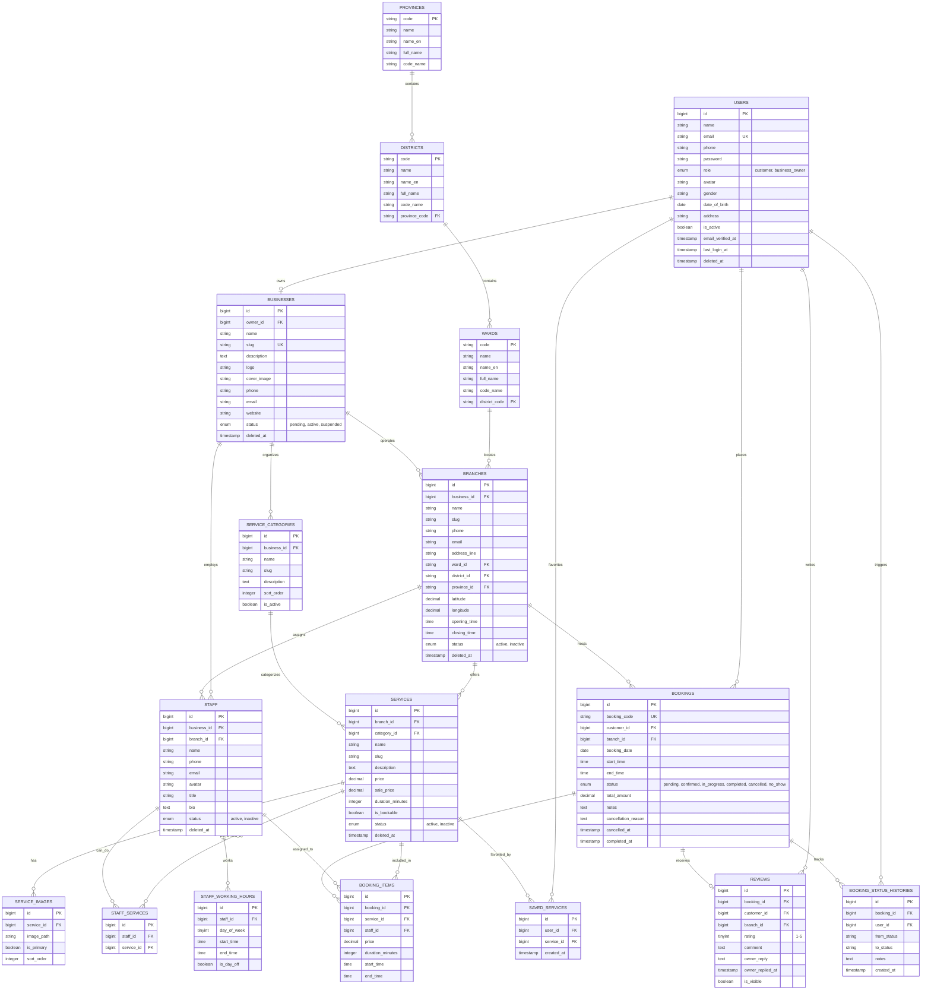

# BeautyBook — Sơ Đồ Thực Thể Quan Hệ (Entity Relationship Diagram - ERD)
**Môn học:** Lập trình Mã nguồn mở (Open Source Programming)  
**Hệ Quản Trị Cơ Sở Dữ Liệu:** MySQL 8.4 LTS / InnoDB Engine  
**Charset/Collation:** `utf8mb4_unicode_ci`

---

## 1. Sơ Đồ ERD Toàn Diện (Mermaid ERD)

---

## 2. Danh Mục Các Bảng & Mô Tả Chi Tiết (Table Catalog)

### 2.1. Nhóm Người Dùng & Quản Trị (Auth & Users)
1. **`users`**: Chứa thông tin đăng nhập, vai trò (`customer` hoặc `business_owner`), thông tin cá nhân và thời điểm hoạt động.
2. **`password_reset_tokens`**: Quản lý mã khôi phục mật khẩu.
3. **`sessions`**: Lưu trữ phiên làm việc của người dùng khi sử dụng database session driver.

### 2.2. Nhóm Địa Giới Hành Chính Việt Nam (Vietnam Locations)
4. **`provinces`**: Danh mục Tỉnh/Thành phố trực thuộc Trung ương (Hà Nội, TP. Hồ Chí Minh, Đà Nẵng, Cần Thơ, v.v.).
5. **`districts`**: Danh mục Quận/Huyện liên kết với Tỉnh/Thành.
6. **`wards`**: Danh mục Phường/Xã liên kết với Quận/Huyện.

### 2.3. Nhóm Doanh Nghiệp & Chi Nhánh (Business & Branches)
7. **`businesses`**: Doanh nghiệp làm đẹp / thương hiệu chính, thuộc quyền sở hữu của `User` có vai trò `business_owner`.
8. **`branches`**: Các cơ sở / chi nhánh thực tế của thương hiệu. Mỗi chi nhánh có tọa độ kinh/vĩ độ, khung giờ mở cửa và địa chỉ hành chính.

### 2.4. Nhóm Dịch Vụ & Danh Mục (Services & Categories)
9. **`service_categories`**: Danh mục phân loại dịch vụ nội bộ của thương hiệu (Chăm sóc da, Làm tóc, Nail Art, Massage trị liệu,...).
10. **`services`**: Dịch vụ cụ thể được cung cấp tại chi nhánh kèm giá niêm yết, giá khuyến mãi và thời lượng thực hiện (phút).
11. **`service_images`**: Thư viện ảnh của dịch vụ phục vụ hiển thị carousel và banner.
12. **`saved_services`**: Bảng nối đa-đa thể hiện danh sách dịch vụ yêu thích của khách hàng.

### 2.5. Nhóm Nhân Sự (Staff & Scheduling)
13. **`staff`**: Đội ngũ chuyên viên, kỹ thuật viên tại từng chi nhánh.
14. **`staff_working_hours`**: Lịch làm việc tuần (Thứ Hai đến Chủ Nhật) cùng khung giờ trực ca của nhân viên.
15. **`staff_services`**: Bảng nối kỹ năng dịch vụ mà nhân viên có thể thực hiện.

### 2.6. Nhóm Đặt Lịch & Đánh Giá (Bookings, Audit Trail & Reviews)
16. **`bookings`**: Đơn hẹn chính giữa khách hàng và chi nhánh, lưu trữ mã đặt lịch định danh duy nhất (VD: `BK20260918-ABCD`), thời gian, tổng chi phí và trạng thái hiện tại.
17. **`booking_items`**: Chi tiết dịch vụ và nhân viên được chỉ định cho từng dịch vụ trong lịch hẹn.
18. **`booking_status_histories`**: Nhật ký kiểm toán (Audit Trail) ghi lại mọi thay đổi trạng thái kèm người thực hiện và ghi chú.
19. **`reviews`**: Đánh giá số sao (1-5), nhận xét của khách hàng sau khi dịch vụ hoàn tất, và phản hồi chính thức từ chủ tiệm.

---

## 3. Chiến Lược Đánh Chỉ Mục & Toàn Vẹn Dữ Liệu (Indexes & Integrity)

- **Khóa chính & Khóa ngoại:** Tất cả bảng giao dịch đều sử dụng `bigint UNSIGNED AUTO_INCREMENT` làm khóa chính và có khóa ngoại `FOREIGN KEY` với các ràng buộc `ON DELETE CASCADE` hoặc `ON DELETE SET NULL` phù hợp.
- **Unique Indexes:**
  - `users.email`
  - `businesses.slug`
  - `bookings.booking_code`
  - `saved_services (user_id, service_id)`
  - `staff_services (staff_id, service_id)`
- **Search & Filter Indexes:**
  - `services (branch_id, status, is_bookable)`
  - `services (category_id, status)`
  - `bookings (customer_id, status, booking_date)`
  - `bookings (branch_id, status, booking_date)`
  - `reviews (branch_id, rating, is_visible)`
- **Soft Deletes:**
  - Áp dụng trên `users`, `businesses`, `branches`, `services`, `staff` để bảo toàn lịch sử giao dịch và thống kê doanh thu ngay cả khi người dùng xóa tài nguyên.
