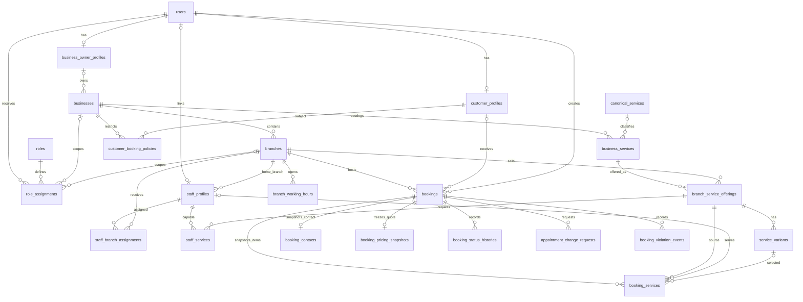
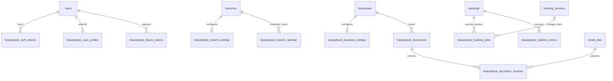
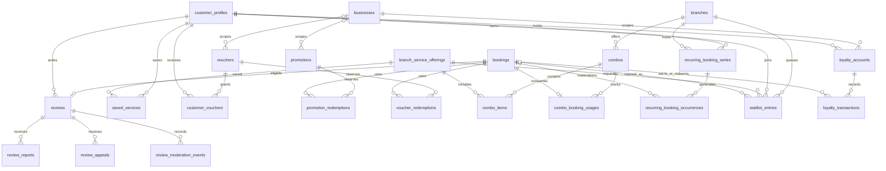
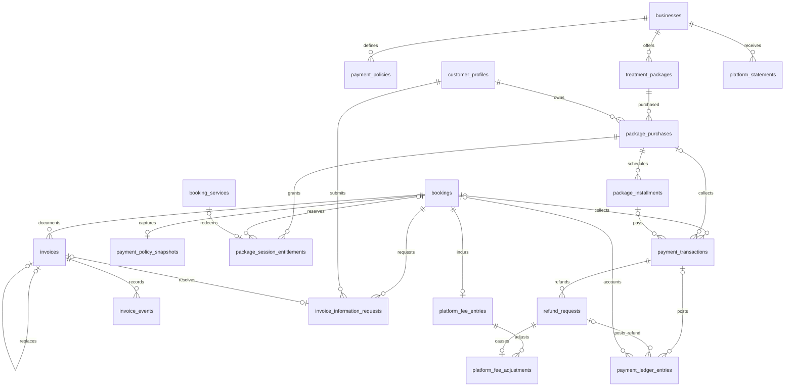
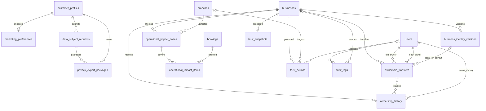

# ERD và use case BeautyBook Laravel

Cập nhật 07/10/2026 từ migration Laravel trong `database/migrations`. Sơ đồ dùng tên bảng hiện có, chia theo nhóm để dễ thuyết trình; đây là quan hệ chính, không liệt kê mọi cột/index/FK. Thiết kế ngày 23/09 là lịch sử: các tên đích cũ như `payments`, `review_service_ratings`, `business_comments` không đại diện schema Laravel hiện tại.

## Identity, catalog và booking

Giao diện chính dùng React BeautyBook nguồn, nạp qua `resources/views/beautybook.blade.php`; controller/service/Eloquent và database nghiệp vụ vẫn là Laravel/MySQL. Nginx phục vụ asset và Socket.IO cùng origin; transport realtime xác minh quyền qua Laravel.

`bookings` dùng FK ghép Branch/Business. `booking_services` có FK ghép tới booking, offering, catalog, staff và variant để giữ scope. Counter booking có thể không có customer profile; contact thuộc booking và không cấp quyền tài khoản Customer. Điều kiện có item và contact/account hợp lệ được bảo vệ tại service, không thể suy ra đầy đủ từ cardinality. Giá/thời lượng/tên dịch vụ có snapshot; sửa catalog không viết lại lịch sử.

Các bảng adapter bổ sung phục vụ hợp đồng frontend nguồn:

`role_assignments.expires_at` là hạn quyền UTC. `beautybook_source_entities` ánh xạ ID Laravel sang UUID/metadata minh họa nguồn; không thay khóa nghiệp vụ bằng UUID nguồn. Event journal ghi trong transaction bằng trigger, rollback không phát sự kiện đã hủy. Chi tiết từng FK/index vẫn lấy migration làm căn cứ.

## Engagement, discount và scheduling

Review có `booking_id` unique; rating từng dịch vụ và reply lưu trong review thay vì bảng rating/comment độc lập của nguồn. Occurrence có booking nullable để biểu diễn chưa tạo được booking. Reservation/quota, combo usage và loyalty cập nhật trong transaction; preview availability không thay lần kiểm tra dưới khóa khi commit.

## Finance

Finance lưu tiền dạng số nguyên `amount_cents`. Booking của payment transaction/ledger được mở nullable trong migration nâng cao để hỗ trợ package purchase. Reversal tham chiếu giao dịch gốc; refund không xóa giao dịch verified. Statement lưu lines snapshot JSON, không có bảng statement lines riêng. Invoice có buyer/seller/lines snapshot: nghiệp vụ hóa đơn đồ án không tự chứng minh đã kết nối hệ thống hóa đơn bên ngoài.

## Privacy, ownership và governance

Identity payload và privacy export mã hóa; token download lưu hash và có TTL/one-use. Tiếp nhận privacy request không đồng nghĩa mọi yêu cầu ERASURE/RECTIFICATION đã xử lý. Ownership thay owner profile/role assignment trong transaction, thu hồi session và kiểm tra nghĩa vụ payment/refund. Impact items giữ snapshot lịch bị ảnh hưởng và replacement references; đóng branch phải kiểm tra case còn khớp lịch hiện hành.

## Use case và quyền

| Luồng | Actor | Điều kiện / kết quả | Nhánh từ chối cần demo |
| --- | --- | --- | --- |
| Khám phá/search/pagination | Guest và tài khoản | Public-ready Business/Branch/offering; SQL-backed results | Offering chưa public không lộ dữ liệu riêng |
| CRUD catalog/branch/staff/upload | Business Owner | Selected workspace đúng scope; validation/capability | Owner A sửa Business B; file sai; foreign staff |
| Booking/favorite/review | Customer | Self-only; quote authoritative, policy/hours/availability; review own completed booking | Spoof customer/price; trùng slot; review chưa completed |
| Counter booking/check-in/no-show/collection | Owner/Receptionist | Scope, account hoặc contact, state/time gate; verified payment/ledger | Nhầm branch; overcollection; no-show trước grace |
| Start/complete item | Assigned Staff; Owner theo quyền nguồn | Provider/state hợp lệ; ghi giờ thực tế; hoàn tất item không tự hoàn tất booking | Staff khác; provider còn thực hiện lịch quá giờ; stale revision/terminal replay |
| Cancellation/reschedule | Customer → Owner/Receptionist tùy trường hợp | Cutoff/approval/history/policy points; quota transition | Approve trùng; foreign scope; cutoff race |
| Voucher/combo/recurring/waitlist/loyalty | Customer; Owner cấu hình | Entitlement/quota, expansion, conflict preview, token TTL, balance ledger | Voucher cạn; claim conflict/replay; điểm vượt số dư |
| Refund/package/invoice/statement | Actor theo `FinanceScope` | Maker/checker, amount cap, policy/entitlement/document snapshots | Sai quyền; refund vượt tiền thu; foreign invoice |
| Moderation/users/settings/trust | Platform Admin | Selected platform workspace; scope/audit | Owner gọi admin action; grant trái account separation |
| Branch lifecycle và impact | Admin/Owner tùy transition | Readiness/review; case khớp booking hiện hành | Owner tự approve; close bỏ qua lịch mới |
| Ownership | Owner → operational recipient → Admin | Accept, verified legal/payout, effective date, nghĩa vụ đã giải quyết | Customer recipient; trước hạn; pending payment/refund |
| Privacy export | Customer | Password reauth; encrypted self export; one-use download | Sai password; foreign package; expiry/reuse |

Menu không tự cấp quyền. Middleware/controller/Gate/Policy/service quyết định điều kiện chính xác; test tương ứng tại [RUBRIC_TRACEABILITY.md](RUBRIC_TRACEABILITY.md).

## Kịch bản thuyết trình năm vai trò

Setup/migrate/seed theo [README.md](../../README.md). `IdentityDemoSeeder` tạo tài khoản local dưới đây với password demo `BeautyBook123!`; `owner2@beautybook.local` dùng kiểm tra tenant khác.

| Vai trò | Tài khoản | Thao tác | Bằng chứng nên chụp |
| --- | --- | --- | --- |
| Customer | `customer@beautybook.local` | Search, favorite, đặt slot hợp lệ, xem quote/voucher/lịch/notification; review sau completed; export có reauth | Filter, confirmation và price snapshot, review, download one-use |
| Business Owner | `owner@beautybook.local` | Chọn workspace; quản lý catalog/branch/staff/offering/capability; voucher/combo; xem lịch/finance | Field errors, catalog cập nhật, branch offering; scope Business B bị chặn |
| Receptionist | `receptionist@beautybook.local` | Counter booking contact, check-in; CASH hoặc BANK_TRANSFER theo quyền; request thay đổi | Contact không cấp Customer rights, branch board, receipt/ledger, lỗi overcollection |
| Staff | `staff@beautybook.local` | Mở lịch được phân công; start/complete item đủ điều kiện | Item/state/history; staff khác bị từ chối |
| Platform Admin | `admin@beautybook.local` | Review branch, directory/settings/audit; moderation hoặc trust; user status/grants | Review/publish state, audit actor/scope; action trái quyền bị chặn |

Chọn thời điểm đáp ứng lead-time/hours và state/time gates. Biên completed/no-show dùng test clock control trên DB test thay vì sửa dữ liệu demo để vượt service. Chọn thêm một luồng mở rộng có dữ liệu thật: recurring conflict, waitlist claim, refund maker/checker hoặc ownership. Chụp desktop/tablet/mobile bằng browser thực và ghi lệnh/ngày/test result vào báo cáo nghiệm thu; tài liệu này không tự xác nhận browser QA đã pass.

