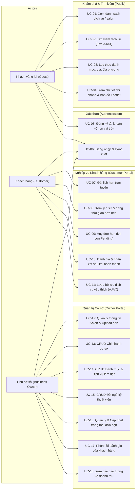

# BeautyBook — Đặc Tả Ca Sử Dụng (Use Case Specification)
**Môn học:** Lập trình Mã nguồn mở (Open Source Programming)  
**Phiên bản:** BeautyBook — Open Source Programming Edition (Laravel 11 Full-Stack)

---

## 1. Sơ Đồ Ca Sử Dụng Tổng Quát (Mermaid Use Case Diagram)

---

## 2. Chi Tiết Các Luồng Nghiệp Vụ Chính (Core Scenarios)

### 2.1. Đặt Lịch Hẹn Trực Tuyến (Customer Booking Flow)
- **Actor:** Khách hàng (Customer).
- **Điều kiện tiên quyết:** Đã đăng nhập vào hệ thống với vai trò `customer`.
- **Luồng chính:**
  1. Khách hàng xem trang dịch vụ hoặc chi nhánh, bấm nút **"Đặt lịch hẹn"**.
  2. Hệ thống chuyển hướng tới giao diện đặt hẹn (`/customer/bookings/create`).
  3. Khách hàng lựa chọn:
     - Chi nhánh làm đẹp;
     - Ngày thực hiện (tối thiểu từ ngày hiện tại);
     - Khung giờ mong muốn;
     - Một hoặc nhiều dịch vụ cần làm;
     - Ghi chú thêm (nếu có).
  4. Hệ thống tự động tính toán tổng số tiền thanh toán dự kiến và tổng thời lượng thực hiện.
  5. Khách hàng gửi yêu cầu; Form Request `BookingCreateRequest` kiểm tra tính hợp lệ dữ liệu phía máy chủ.
  6. Hệ thống tạo mã đặt lịch duy nhất (`BK-YYYYMMDD-XXXX`), lưu thông tin với trạng thái `pending`, ghi nhận bản ghi kiểm toán vào `booking_status_histories` và chuyển hướng về trang chi tiết đơn hẹn.

### 2.2. Xử Lý Vòng Đời Đơn Hẹn (Owner Booking Management Flow)
- **Actor:** Chủ cơ sở làm đẹp (Business Owner).
- **Luồng chính:**
  1. Chủ cơ sở truy cập portal quản trị (`/owner/bookings`).
  2. Bảng dữ liệu hiển thị toàn bộ đơn hẹn của các chi nhánh trực thuộc, phân loại theo trạng thái.
  3. Chủ cơ sở có thể thay đổi trạng thái đơn hẹn nhanh chóng qua hộp chọn AJAX:
     - `pending` ➔ `confirmed`: Xác nhận tiếp nhận lịch;
     - `confirmed` ➔ `in_progress`: Khách đã đến và bắt đầu thực hiện;
     - `in_progress` ➔ `completed`: Khách đã làm xong dịch vụ;
     - Chuyển sang `cancelled` (kèm lý do) hoặc `no_show` (nếu khách vắng mặt).
  4. Mỗi lần thay đổi trạng thái, hệ thống kích hoạt tạo bản ghi lịch sử kiểm toán ghi nhận người thao tác và thời điểm.
